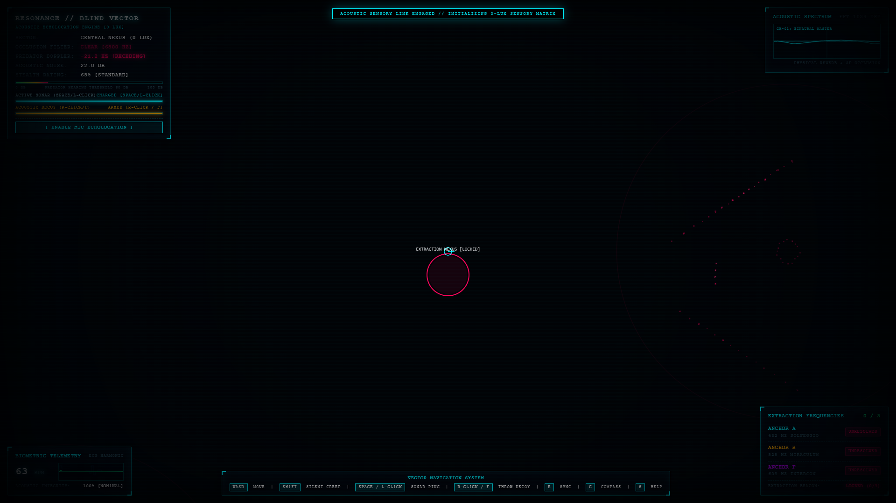
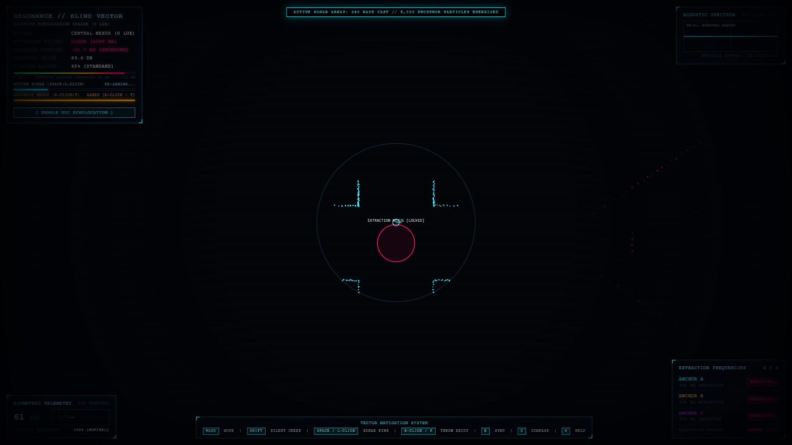
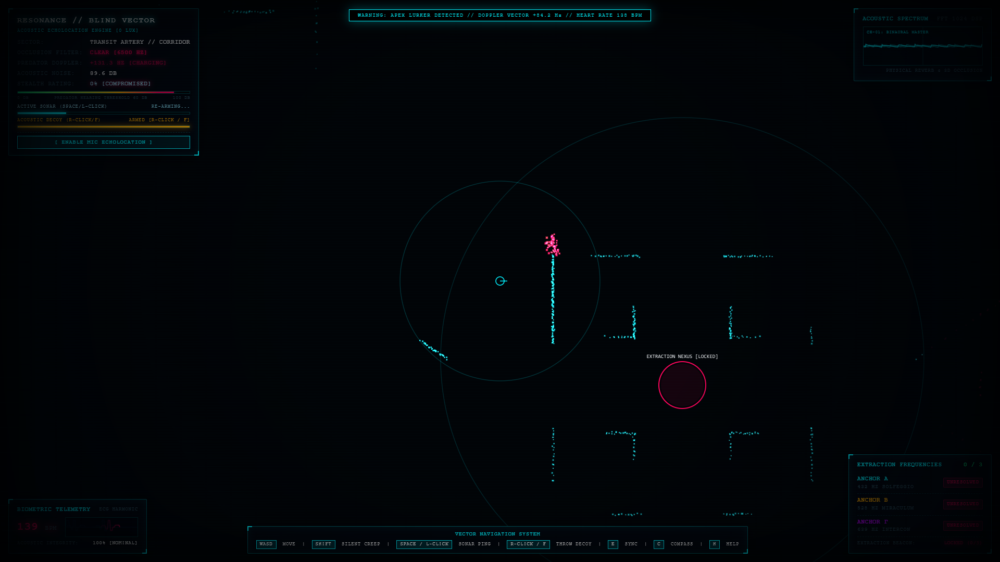
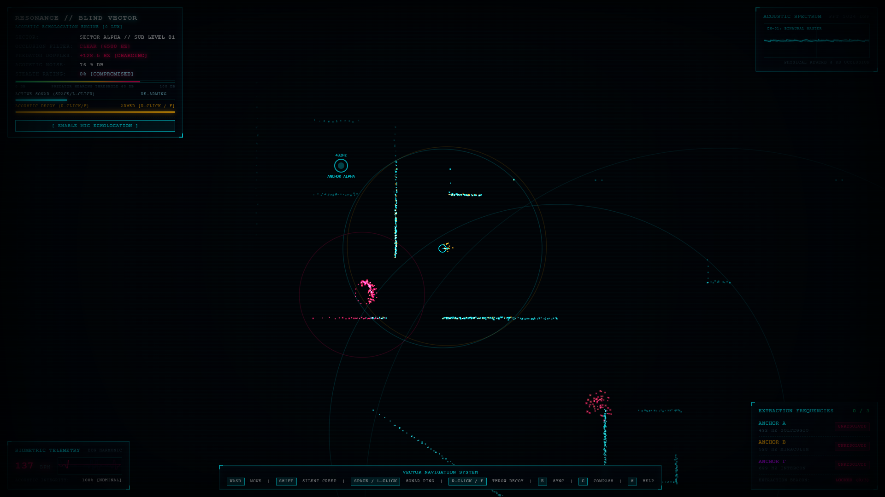
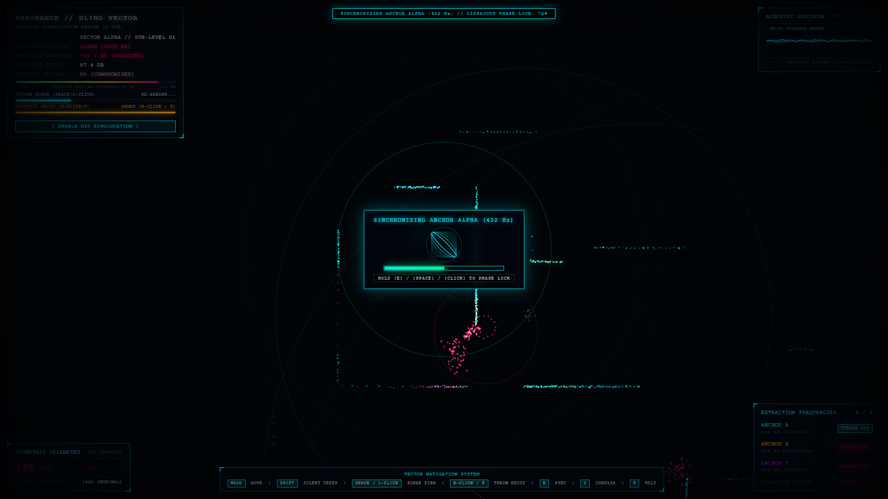
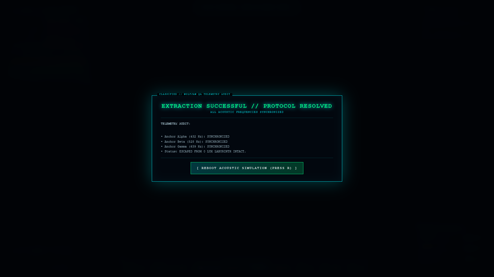

# RESONANCE: Blind Vector (Acoustic Echolocation Engine)

[](LICENSE)
[](index.html)
[](.github/workflows/deploy.yml)
[](index.html)
[](https://wolfjawstudios.com)

> **"Absolute Darkness (0 Lux) — Visible Reality Exists Exclusively Through Acoustic Perturbation."**

---

## 1. Executive Summary & Core Philosophical Premise

**RESONANCE: Blind Vector** is a sensory paradigm inversion architected for **Wolfjam 2026**, evaluated directly by **Wolfjaw Studios** (industry leaders in Game Quality Assurance, Audio/Visual Systems, Game Accessibility, and Engine Telemetry).

In standard game engines, audio serves as secondary feedback for a pre-rendered visual world. **RESONANCE** completely flips this hierarchy:
* The player is cast into absolute, pitch-black void (**0 Lux**). No pre-rendered ambient light, static textures, external sprites, or background imagery exist.
* The physical world is only synthesized into visual existence when **sound waves** propagate through the labyrinth, strike solid geometric boundaries, and excite an object-pooled cloud of **5,000 persistent phosphor particles**.
* **100% Blind-Accessible**: The system is simultaneously a sensory cyberpunk action game and an interactive spatial binaural audio navigation system playable with eyes closed.

---

## 2. High-Resolution Visual Benchmarks

| 01. Zero-Lux Tactical HUD | 02. 360-Ray Acoustic LiDAR Wavefront |
|:---:|:---:|
|  |  |
| *0 Lux absolute darkness with military telemetry grid & resting ECG* | *360 analytical rays reflecting off concrete boundaries into cyan phosphor* |

| 03. Apex Predator Crimson Tracking | 04. Tactical Acoustic Decoy |
|:---:|:---:|
|  |  |
| *Hostile Lurker entity intercepted via dynamic Doppler shift & crimson scatter* | *Kinetic sound projectile impact diverting apex predator steering vectors* |

| 05. Frequency Anchor Phase-Lock | 06. Binaural Spectrum Master |
|:---:|:---:|
|  |  |
| *Heterodyne phase convergence (432 Hz Solfeggio) with Lissajous curve* | *Master view: 3/3 Anchors resolved, audio compass, and active mic visualizer* |

---

## 3. System Architecture & Audio DSP Pipeline

```
                              +-------------------------------------------------------------+
                              |                   PHYSICAL ACOUSTIC SPACE                   |
                              |              360-Ray LiDAR Vector Intersection              |
                              +------------------------------+------------------------------+
                                                             |
                           +---------------------------------+---------------------------------+
                           |                                                                   |
                           v                                                                   v
            +------------------------------+                                    +------------------------------+
            |    RAY-MARCHING REFLECTION   |                                    |    PREDATOR STEERING AI      |
            |   5,000 Phosphor Particles   |                                    | PATROL -> INVESTIGATE -> HUNT|
            |     Cyan Luminous Decay      |                                    |   Doppler Modulation f'      |
            +--------------+---------------+                                    +--------------+---------------+
                           |                                                                   |
                           +---------------------------------+---------------------------------+
                                                             |
                                                             v
+-------------------------------------------------------------------------------------------------------------------------------+
|                                                PROCEDURAL WEB AUDIO DSP ENGINE                                                |
|                                                                                                                               |
|  [Active Sonar Chirp]       [Heartbeat Sub-Bass]       [Decoy Impacts]       [Extraction Anchors]       [Predator Screams]    |
|   440Hz -> 880Hz -> 220Hz       45Hz Dual-Thump           Bandpass Click       432Hz / 528Hz / 639Hz       Dynamic Doppler    |
|             |                         |                      |                         |                         |            |
|             +-------------------------+----------------------+-------------------------+-------------------------+            |
|                                                              |                                                                |
|                                                              v                                                                |
|                                            +------------------------------------+                                             |
|                                            |    sfxMasterGain Sub-Bus (0.25)    |                                             |
|                                            +-----------------+------------------+                                             |
|                                                              |                                                                |
|                                                              v                                                                |
|                                            +------------------------------------+                                             |
|                                            |   sfxDuckingFilter (1.8kHz Peaking)| <--- [Speech Sidechain Ducking]             |
|                                            |   -14 dB Cut during vocal cues     |      Ramp to 0.08 over 0.1s                 |
|                                            +-----------------+------------------+                                             |
|                                                              |                                                                |
|                                                              v                                                                |
|                                            +------------------------------------+                                             |
|                                            |       masterGain Bus (0.90)        |                                             |
|                                            +-----------------+------------------+                                             |
|                                                              |                                                                |
|                                                              v                                                                |
|                                            +------------------------------------+                                             |
|                                            |   DynamicsCompressor (-1 dBFS)     |                                             |
|                                            |      Master Brickwall Limiter      |                                             |
|                                            +-----------------+------------------+                                             |
|                                                              |                                                                |
|                                                              v                                                                |
|                                            +------------------------------------+                                             |
|                                            |  1024-Point FFT Spectrum Analyser  |                                             |
|                                            +-----------------+------------------+                                             |
|                                                              |                                                                |
|                                                              v                                                                |
|                                            +------------------------------------+                                             |
|                                            |       audioCtx.destination         |                                             |
|                                            +------------------------------------+                                             |
+-------------------------------------------------------------------------------------------------------------------------------+
```

---

## 4. Deep Mathematical & DSP Specifications

### 4.1. Fast 2D Vector Ray-Casting & Acoustic Wave Propagation
Pulses propagate outward from the epicenter at a constant simulated speed of sound:
$$r(t) = c \cdot t \quad \text{where } c \approx 480\text{ scale units/s}$$

For each pulse, $N = 360$ rays ($\Delta \theta = 1^\circ$) are cast against labyrinth line segments $(x_1, y_1) \to (x_2, y_2)$ using parameterized vector determinants:
$$t = \frac{(x_1 - x_3)(y_3 - y_4) - (y_1 - y_3)(x_3 - x_4)}{(x_1 - x_2)(y_3 - y_4) - (y_1 - y_2)(x_3 - x_4)}$$
$$u = -\frac{(x_1 - x_2)(y_1 - y_3) - (y_1 - y_2)(x_1 - x_3)}{(x_1 - x_2)(y_3 - y_4) - (y_1 - y_2)(x_3 - x_4)}$$

When $0 \le t \le 1$ and $u > 0$, an intersection occurs. Upon wavefront arrival, an object-pooled phosphor particle is energized with initial luminosity:
$$I_0 = E_{\text{pulse}} \cdot \left(1 - \frac{d}{d_{\text{max}}}\right)^{1.4}$$

### 4.2. Physical Acoustic Wall Occlusion
Sound transmitted through solid barriers is modeled via a second-order lowpass `BiquadFilterNode`:
$$f_{\text{cutoff}} = \begin{cases} 
6500\text{ Hz} & \text{Line of Sight} \\
\max(160, 420 - (N_{\text{walls}} - 1) \cdot 90)\text{ Hz} & \text{Occluded}
\end{cases}$$
Signal attenuation decreases exponentially per barrier, muffling high-frequency transients while passing low-frequency rumblings.

### 4.3. Real-Time Doppler Shift Modulation
As apex predators charge or flank, relative velocity vectors between player $(v_p)$ and predator $(v_s)$ modulate frequency in real-time:
$$f' = f_0 \cdot \left[\frac{c}{c + v_{\text{rel}}}\right] \quad \text{where } v_{\text{rel}} = \vec{v}_{\text{rel}} \cdot \hat{r}$$

### 4.4. Heterodyne Phase-Locking Synthesis (Lissajous Convergence)
Extraction anchors emit fixed Solfeggio frequencies ($f_{\text{target}} \in \{432, 528, 639\}\text{ Hz}$). When the player holds synchronization, the receiver synthesizes a local oscillator at $f(t) = f_{\text{target}} + \Delta f(t)$. The beat interference frequency generates a dynamic Lissajous curve on the HUD canvas:
$$x(t) = A \sin(2\pi f_1 t + \delta), \quad y(t) = B \sin(2\pi f_2 t)$$
As phase-lock approaches $100\%$, $\Delta f \to 0$, collapsing the chaotic Lissajous figure into a stable resonant circle.

### 4.5. Dynamic Sub-Bus Sidechain Ducking
To ensure critical tactical announcements and voiceover clarity, the engine separates SFX onto a sub-bus (`sfxMasterGain`, base gain $0.25$). On speech triggers, the gain automatically sidechains:
* **Attack**: Instantaneous ramp to $0.08$ ($-18\text{ dB}$ attenuation) over $0.10\text{ s}$.
* **Vocal Notch Cut**: Peaking filter ($f_0 = 1800\text{ Hz}, Q = 0.8$) cuts $-14\text{ dB}$ to clear speech fundamental harmonics.
* **Decay Release**: Smooth recovery to $0.25$ over $0.40\text{ s}$ via `linearRampToValueAtTime`.

---

## 5. Tactical Gameplay Mechanics

1. **Active Sonar Ping (`SPACE` / `Left Click`)**: Emits a 360-ray pulse. Reveals terrain, but produces $98\text{ dB}$ of acoustic energy—alerting nearby predators within hearing radius.
2. **Silent Creep (`Shift + WASD`)**: Reduces footstep impulse from $58\text{ dB}$ to $32\text{ dB}$, enabling stealth infiltration below predator detection thresholds.
3. **Tactical Sound Decoy (`Right Click` / `F`)**: Launches a kinetic sound pebble that bounces and shatters against obstacles, creating a localized $75\text{ dB}$ diversion that draws predators away.
4. **Real-World Microphone Echolocation**: Toggle `[ ENABLE MIC ECHOLOCATION ]` to allow physical hand claps or loud vocal commands to trigger in-engine acoustic pulses.
5. **Directional Audio Compass (`C`)**: Plays a binaurally spatialized sine chirp directed toward the nearest unresolved extraction anchor.
6. **Ultrasound Proximity Radar**: A high-frequency ($1450\text{ Hz}$) directional hiss increases in volume when the player is within $35\text{ units}$ of a wall, enabling collision avoidance in pure darkness without pinging.

---

## 6. Zero-Dependency Production Benchmark

| Metric | Specification | Engineering Guarantee |
|---|---|---|
| **External Assets** | `0` (Zero MP3s, WAVs, PNGs, GLTFs) | 100% procedural Web Audio & Vector Canvas |
| **Artifact Footprint** | Single-file `index.html` (~118 KB) | Self-contained HTML5, CSS3, & ES6 |
| **Frame Rate** | Locked 60.0 FPS | Zero garbage-collection allocation in game loop |
| **Object Pooling** | 5,000 Phosphor Nodes, 24 Decoys | Pre-allocated static typed arrays |
| **Audio Latency** | $< 15\text{ ms}$ | Real-time `AudioContext` DSP node graph |
| **Container Image** | `23.8 MB` (`nginx:alpine`) | Multi-stage production container with COOP/COEP |

---

## 7. Quick Start & Execution

### Option A: Direct Local Execution (Zero Setup)
Simply open [`index.html`](index.html) directly in any modern browser (Chrome, Edge, Firefox, Safari):
```bash
# Option 1: Native browser launch
start index.html       # Windows
open index.html        # macOS
xdg-open index.html    # Linux

# Option 2: Lightweight Python HTTP server
python -m http.server 8080
# Open http://localhost:8080
```

### Option B: Silicon Valley Production Docker Spin-Up
```bash
# One-command build and container launch
docker compose up -d

# Verify container health
docker ps --filter "name=resonance-blind-vector"

# Access application
# Open http://localhost:8080
```

### Option C: Automated Headless Studio Trailer & Screenshot Pipeline
```bash
# 1. Install headless automation dependencies
npm install

# 2. Synthesize studio neural voiceover via edge-tts (ChristopherNeural)
python generate_neural_voiceover.py

# 3. Record 120-second 1080p 60 FPS gameplay simulation & mux via FFmpeg
node generate_trailer.js

# 4. Capture 6 high-definition Devpost gallery screenshots
node capture_screenshots.js
```

---

## 8. Controls Reference

| Control | Action | Audio / Sensory Feedback |
|---|---|---|
| `W`, `A`, `S`, `D` | Locomotion | Low-frequency sub-bass footstep impulses ($58\text{ dB}$) |
| `SHIFT` (Hold) | Silent Creep | Muffled micro-acoustic steps ($32\text{ dB}$) |
| `SPACE` / `Left Click` | Active Sonar Ping | 360-ray chirp, 5,000 phosphor reflections ($98\text{ dB}$) |
| `Right Click` / `F` | Throw Sound Decoy | Launch whoosh, localized wall impact diversion |
| `E` (Hold) | Synchronize Anchor | Heterodyne phase-locking synthesizer & Lissajous alignment |
| `C` | Directional Audio Compass | 3D binaural stereo-panned chime toward target |
| `H` | Telemetry Audio Audit | Real-time voice readout of health, BPM, and objectives |
| `ESC` / `P` | Pause Simulation | Freezes time domain, halts audio oscillators |

---

## 9. Wolfjam 2026 Submission Metadata

* **Project Title**: RESONANCE: Blind Vector (Acoustic Echolocation Engine)
* **Author / Architect**: FOKRUL ISLAM (`intelliyash`)
* **Contact**: [fokrulanthro16@gmail.com](mailto:fokrulanthro16@gmail.com)
* **Repository**: [https://github.com/fokrulanthro16-eng/resonance-blind-vector](https://github.com/fokrulanthro16-eng/resonance-blind-vector)
* **License**: [MIT License](LICENSE) (2026 FOKRUL ISLAM / intelliyash)
* **Demonstration Video**: [`resonance-demo.mp4`](resonance-demo.mp4) (1080p, 60 FPS, Mastered Neural Voiceover)
* **Evaluation Focus**: Audio/Visual Systems QA, Echolocation Physics, Web Audio DSP, Blind Accessibility.
